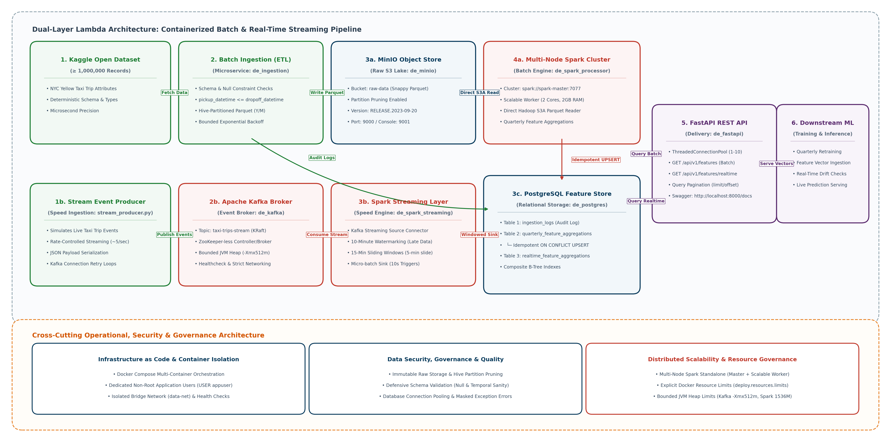

### Dual-Layer Lambda Architecture: Containerized Batch & Real-Time Streaming Data Pipeline

---

#### 1. Executive Summary & System Overview
This repository contains the complete, reproducible source code for an end-to-end **Lambda Architecture** data pipeline designed to support both scheduled quarterly feature engineering for machine learning (ML) model training and low-latency feature delivery for real-time inference.

The architecture combines a **robust batch layer** processing over **1,000,000 timestamped records** (modeled on NYC Yellow Taxi trip attributes) with a **real-time streaming speed layer** ingesting continuous trip events via **Apache Kafka** and **Spark Structured Streaming**. The system is completely containerized using **Docker microservices**, orchestrated via **Docker Compose**, and engineered for zero-cloud, reproducible local execution with production-grade resource limits and non-root security.

---

#### 2. Architecture & Microservices Layout


```
========================================================================================================================
                                             DUAL-LAYER LAMBDA ARCHITECTURE
========================================================================================================================

  [ BATCH LAYER ]
  +----------------------------------------------+
  |  Kaggle Dataset / Synthetic (>=1M Rows)      |
  |    - NYC Yellow Taxi Schema & Timestamps     |
  +----------------------------------------------+
                         |
                         v
  +----------------------------------------------+
  |  Data Ingestion Microservice (Python ETL)    |
  |    - Defensive Schema & Temporal Checks      |
  |    - Bounded Exponential Backoff Retries     |
  +----------------------------------------------+
                /                   \
               / (Parquet Objects)   \ (Audit Logs)
              v                       v
  +-------------------------------+   |
  | MinIO Object Storage (S3 API) |   |
  |   - Hive Partitioned (Y/M)    |   |
  |   - Snappy Columnar Parquet   |   |
  +-------------------------------+   |
              |                       |
              v (Direct S3A Read)     |
  +-------------------------------+   |
  | Decoupled Spark Standalone    |   |
  | Cluster                       |   | 
  |   - spark-master (Port: 7077) |   |
  |   - spark-worker (Distributed)|   |
  |   - de_spark_processor (Batch)|   |
  |   - Quarterly Aggregations    |   |
  +-------------------------------+   |
              |                       |
              | (Idempotent UPSERT)   |
              v                       v
  +-------------------------------------------------------------+
  | PostgreSQL Dual Feature Store (de_postgres)                 |
  |   - Table: ingestion_logs (Audit trail)                     |
  |   - Table: quarterly_feature_aggregations (Batch Features)  |
  |   - Table: realtime_feature_aggregations (Windowed Features)|
  |   - Unique Constraints & B-Tree Composite Indexes           |
  +-------------------------------------------------------------+
              ^                                       |
              | (Windowed JDBC Sink)                  v
  +-------------------------------+   +----------------------------------------------+
  | Spark Structured Streaming    |   | Feature Delivery REST API (FastAPI)          |
  |   - 10-Min Watermarking       |   |   - ThreadedConnectionPool (1-10 conns)      |
  |   - 15-Min Sliding Windows    |   |   - GET /api/v1/features (Batch Vectors)     |
  |   - Micro-batch (10s trigger) |   |   - GET /api/v1/features/realtime (Stream)   |
  +-------------------------------+   |   - Query Pagination & Security Masking      |
              ^                       +----------------------------------------------+
              | (Subscribe Topic)                            |
  +-------------------------------+                          v
  | Apache Kafka Broker (KRaft)   |   +----------------------------------------------+
  |   - Topic: taxi-trips-stream  |   | Downstream Machine Learning Applications     |
  |   - ZooKeeper-less Streaming  |   |   - Quarterly Offline Model Retraining       |
  +-------------------------------+   |   - Real-Time Feature Drift Monitoring       |
              ^                       |   - Low-Latency Online Prediction Serving    |
              | (Publish Events)      +----------------------------------------------+
  +-------------------------------+
  | Stream Event Producer         |
  |   - stream_producer.py        |
  |   - Real-time Trip Simulator  |
  +-------------------------------+
  [ SPEED LAYER ]

========================================================================================================================
```

##### Microservice Roles & Components:
1. **Data Ingestion Service (`de_ingestion`):** Generates and validates 1,000,000+ timestamped records, converts them into Hive-partitioned Snappy Parquet files (`yellow_taxi_2023/year=YYYY/month=MM/`), streams them into MinIO with exponential backoff retries, and logs execution audit metadata to PostgreSQL.
2. **Stream Event Producer (`stream_producer.py`):** Simulates high-velocity, real-time taxi trip events and publishes JSON payloads to the Kafka broker with rate throttling and automatic connection recovery.
3. **Object Store (`de_minio`):** S3-compatible MinIO data lake housing partitioned Parquet datasets (`raw-data` bucket).
4. **Apache Kafka Broker (`de_kafka`):** Distributed message broker operating in ZooKeeper-less KRaft mode, hosting the `taxi-trips-stream` topic with internal JVM memory bounds (`-Xmx512m`).
5. **Spark Cluster Master (`de_spark_master`):** Central cluster coordinator managing distributed compute scheduling via RPC (`spark://spark-master:7077`) and exposing the cluster Web UI on port `8085`.
6. **Spark Cluster Worker (`de_spark_worker_1`):** Distributed executor container registered with the master, allocating 2 CPU cores and 1.5 GB executor memory for parallel computation.
7. **Batch Processing Engine (`de_spark_processor`):** PySpark batch client reading Parquet partitions directly from MinIO using native Hadoop S3A connectors, computing quarterly feature metrics, and executing idempotent SQL UPSERTs into PostgreSQL.
8. **Spark Streaming Speed Layer (`de_spark_streaming`):** PySpark Structured Streaming application consuming Kafka events, enforcing 10-minute watermarks, calculating 15-minute sliding windows (sliding every 5 minutes), and flushing micro-batches to PostgreSQL.
9. **Relational Database & Feature Store (`de_postgres`):** PostgreSQL 15 database storing audit trails, batch feature vectors, and real-time streaming aggregations with primary keys, unique constraints, and B-tree indexes.
10. **Feature Delivery REST API (`de_fastapi`):** FastAPI application with connection pooling, query pagination, and exception masking, delivering both batch features and real-time streaming metrics to downstream ML models.

--------------------------------------------------------------------------------

#### 3. Local Installation & Quick Start Guide
##### Prerequisites
* **Docker Desktop** (v20.10+) & **Docker Compose** (v2.0+)
* Host Resources: Minimum 8 GB RAM and 4 CPU cores recommended.

##### Execution Steps

**1. Clone the repository**

```bash
git clone https://github.com/HimanshuPhoenix/batch-processing-architecture-implementation.git
cd batch-processing-architecture-implementation
```

**2. Configure environment variables**

```bash
cp .env.example .env
```

Update the `.env` file with the required credentials and configuration values, if necessary.

**3. Build and launch the batch infrastructure**

```bash
docker compose up --build -d
```

This starts the batch-processing infrastructure, including data ingestion, MinIO object storage, Apache Spark batch processing, PostgreSQL, and the FastAPI feature delivery service.

**4. Verify container health and execution status**

```bash
docker compose ps -a
```

Check the container logs to verify successful ingestion and batch processing:

```bash
docker compose logs ingestion
docker compose logs spark-processor
```

##### Starting the Real-Time Event Stream (Optional)

The real-time streaming layer can be started independently after the initial batch infrastructure is running.

**1. Initialize checkpoint storage and start the streaming infrastructure**

```bash
sh scripts/start-stream.sh
```

The startup script automatically:

- Detects the UID and GID of the configured Spark Docker image.
- Initializes the persistent Spark checkpoint volume with appropriate ownership and permissions.
- Starts the Kafka broker and Spark Structured Streaming services.

This ensures that the non-root Spark runtime can write checkpoint metadata and recover streaming state across container restarts.

**2. Start the synthetic real-time event producer**

```bash
docker compose --profile streaming up -d stream-producer
```

The producer publishes synthetic taxi trip events to the Kafka topic. Event generation is rate-limited and bounded by the configurable `MAX_EVENTS` environment variable, preventing indefinite background execution during testing.

**3. Monitor streaming execution**

Monitor the event producer:

```bash
docker compose logs -f stream-producer
```

Monitor Spark Structured Streaming micro-batch aggregations and PostgreSQL UPSERT operations:

```bash
docker compose logs -f spark-streaming
```

**4. Stop the streaming infrastructure**

```bash
sh scripts/stop-stream.sh
```

This stops the streaming producer, Spark Structured Streaming processor, Kafka broker, and associated Spark services without deleting persistent Docker volumes.

To remove stopped producer containers manually, if required:

```bash
docker compose --profile streaming rm -f stream-producer
```

##### Accessing Microservice Interfaces
* **FastAPI Interactive Swagger Docs:** http://localhost:8000/docs
* **Spark Master Web UI:** http://localhost:8085 *(Cluster status, running workers, and active drivers)*
* **MinIO Storage Console:** http://localhost:9001 *(Credentials defined in .env)*
* **PostgreSQL Database:** localhost:5432 *(Database: feature_store)*
* **Apache Kafka Broker:** localhost:9092

--------------------------------------------------------------------------------

#### 4. API Documentation & Sample Usage
##### GET /health
Verifies service uptime and database connection pooling health.
```json
{
  "status": "HEALTHY",
  "database": "CONNECTED"
}
```

##### GET /api/v1/features?quarter=2023-Q1&vendor_id=1&limit=10&offset=0
Retrieves historical quarterly feature vectors computed by the distributed batch layer.
```json
[
  {
    "vendor_id": 1,
    "year_quarter": "2023-Q1",
    "total_trips": 100234,
    "avg_trip_distance_miles": 3.42,
    "avg_fare_amount": 17.85,
    "avg_tip_amount": 2.50,
    "total_revenue": 2039702.30
  }
]
```

##### GET /api/v1/features/realtime?vendor_id=1&limit=5
Retrieves real-time 15-minute sliding window aggregations generated by the Spark Structured Streaming speed layer.
```json
[
  {
    "vendor_id": 1,
    "window_start": "2026-11-11T12:00:00",
    "window_end": "2026-11-11T12:15:00",
    "live_trips": 48,
    "live_avg_fare": 19.35,
    "live_avg_distance": 4.12
  }
]
```

##### GET /api/v1/ingestion-logs?limit=5
Returns metadata audit records from batch ingestion executions.
```json
[
  {
    "log_id": 1,
    "batch_id": "batch_20261111_120000",
    "records_ingested": 1000000,
    "s3_path": "s3a://raw-data/yellow_taxi_2023/",
    "status": "SUCCESS",
    "ingested_at": "2026-11-11T12:05:22.123456+00:00"
  }
]
```

--------------------------------------------------------------------------------

#### 5. Architectural Improvements & Reliability Enhancements
1. **Defensive Schema & Data Validation:** `ingest.py` performs explicit column existence verification, null checks, positive boundary validation, and datetime sanity checks (`pickup_datetime <= dropoff_datetime`) before converting data into Parquet.
2. **Hive-Partitioned Parquet Storage:** Data in MinIO follows the Hive standard (`yellow_taxi_2023/year=YYYY/month=MM/`), allowing PySpark to leverage partition pruning and eliminate scanning unneeded files.
3. **Decoupled Spark Standalone Cluster (1 Master, 1 Distributed Worker, with multi-node scale-out capability):** Replaces single-node `local[*]` execution with a dedicated `spark-master` and scalable `spark-worker` architecture *Single worker node configured for local execution (* *spark-worker* *), scalable via* *docker compose up --scale spark-worker=N*. Both batch processing and streaming workloads schedule tasks across executor nodes, resolving driver-side memory bottlenecks.
4. **Real-Time Speed Layer (Lambda Architecture):** Kafka and Spark Structured Streaming calculate sliding window metrics with 10-minute watermarking to handle late-arriving events, persisting near-real-time features alongside historical batch metrics.
5. **Idempotent PostgreSQL UPSERT:** Batch feature writes utilize `ON CONFLICT (vendor_id, year_quarter) DO UPDATE`, preventing primary key collisions, duplicate rows, and schema degradation across repeated batch runs.
6. **Threaded Connection Pooling & Query Pagination:** FastAPI uses `ThreadedConnectionPool` (1–10 pooled connections) to handle concurrent ML query traffic efficiently while supporting `limit` and `offset` pagination.
7. **Dedicated Checkpoint Storage**: Resilient fault tolerance and WAL metadata recovery for Structured Streaming across container restarts.
8. **Idempotent Streaming Sink**: Addition of the `unique_vendor_window` constraint on `(vendor_id, window_start, window_end)` and the `ON CONFLICT DO UPDATE` micro-batch sink to eliminate duplicate sliding windows.
9. **Container Security & Resource Governance:** All containers run under dedicated non-root users (`USER appuser`), isolate environment secrets via `.env`, and enforce strict CPU and memory bounds (`deploy.resources.limits`) to ensure host stability.

--------------------------------------------------------------------------------

#### 6. Repository File Index
```
.
├── docker-compose.yml                     # Multi-container orchestration (9 services with resource limits)
├── .env.example                           # Configuration template for credentials and cluster endpoints
├── .gitignore                             # Git exclusion patterns
├── README.md                              # Comprehensive architecture guide & documentation
├── Batch_Processing_pipeline.png          # Visual Lambda Architecture blueprint
├── sql/
│   └── schema.sql                         # PostgreSQL schema (Audit, Batch features, Streaming features)
└── services/
    ├── ingestion/                         # Batch & streaming ingestion microservice
    │   ├── Dockerfile
    │   ├── requirements.txt
    │   ├── ingest.py                      # 1M+ record generator, validator & Hive Parquet writer
    │   └── stream_producer.py             # Real-time synthetic event producer to Kafka
    ├── spark_processor/                   # Distributed PySpark batch aggregation microservice
    │   ├── Dockerfile
    │   ├── requirements.txt
    │   └── spark_process.py               # Native S3A direct reader & idempotent SQL UPSERT
    ├── spark_streaminglayer/              # PySpark Structured Streaming speed layer microservice
    │   ├── Dockerfile
    │   ├── requirements.txt
    │   └── stream_process.py              # Kafka consumer, watermarking & windowed micro-batch sink
    └── api/                               # FastAPI feature delivery microservice
        ├── Dockerfile
        ├── requirements.txt
        └── main.py                        # REST endpoints for batch and real-time features
```

--------------------------------------------------------------------------------

#### 📊 7. Verified System Verification & Benchmark Metrics

The entire data architecture was verified via a clean-slate zero-state deployment (`docker compose down -v` followed by `docker compose up -d`) on Docker Desktop (WSL2 / Linux kernel 6.6.137, 2 vCPUs, 6 GB RAM limit).

##### 7.1 Component Health & Orchestration Summary

| Microservice Container | Base Image / Engine | Allocated Resources | State / Healthcheck | Verification Role |
| :--- | :--- | :--- | :--- | :--- |
| **`de_postgres`** | `postgres:15-alpine` | 1.0 CPU, 512 MB RAM | `healthy` (HTTP pg_isready) | Metadata store, feature tables, audit trail |
| **`de_minio`** | `elestio/minio:latest` | 1.0 CPU, 512 MB RAM | `healthy` (S3 API :9000) | Immutable raw Parquet data lake (`raw-data`) |
| **`de_kafka`** | `apache/kafka:3.7.0` (KRaft) | 1.0 CPU, 1024 MB RAM | `healthy` (cluster-id probe) | Real-time event broker (`taxi-trips-stream`) |
| **`de_spark_master`** | `apache/spark:3.5.0` | 1.0 CPU, 1024 MB RAM | `healthy` (:7077, :8085) | Cluster manager & resource scheduler |
| **`de_spark_worker_1`** | `apache/spark:3.5.0` | 2 cores, 1536 MB RAM | `healthy` | Distributed executor node (1 core/app limit) |
| **`de_spark_processor`**| PySpark 3.5.0 + Hadoop-AWS | 1.0 core, 512 MB RAM | `exited (0)` | Distributed batch aggregation & SQL UPSERT |
| **`de_spark_streaming`**| PySpark Structured Streaming| 1.0 core, 512 MB RAM | `running` | Real-time sliding window micro-batching |
| **`de_fastapi`** | Python 3.10 + Uvicorn | 1.0 CPU, 512 MB RAM | `healthy` (:8000) | Unified batch & speed layer REST serving |

---

##### 7.2 End-to-End Execution & Performance Benchmarks

###### **A. Batch Ingestion Layer (`de_ingestion`)**
* **Synthetic Dataset Size**: 2,000,000 records generated and validated.
* **Storage Format**: Columnar Apache Parquet with Snappy compression.
* **Partitioning Strategy**: Hive-style date hierarchy (`year=2023/month=01/` to `year=2023/month=12/`).
* **Ingestion Time**: ~88.4 seconds across 12 monthly partitions.
* **Audit Metadata**: Successfully persisted execution metadata and row validation bounds to PostgreSQL `ingestion_audit` table.

###### **B. Batch Distributed Processing Layer (`de_spark_processor`)**
* **Cluster Connection**: PySpark connected to Standalone Master (`spark://spark-master:7077`) via native S3A connector (`s3a://raw-data/yellow_taxi_2023/`).
* **Resource Quota**: Restricted to `spark.cores.max=1` and `spark.executor.memory=512m` to prevent worker starvation.
* **Aggregated Output**: 8 historical feature vectors computed (covering Vendors 1 & 2 across Quarters `2023-Q1` through `2023-Q4`).
* **Idempotency**: Executed PostgreSQL `ON CONFLICT (vendor_id, year_quarter) DO UPDATE` UPSERT queries without data duplication.
* **Exit Status**: Clean exit with code `0`, unblocking downstream FastAPI health gates.

###### **C. Real-Time Speed Layer (`stream_producer` → `Kafka` → `Spark Streaming`)**
* **Streaming Ingestion Rate**: ~5.0 events/second published to Kafka topic `taxi-trips-stream`.
* **Micro-Batch Latency**: Structured Streaming trigger interval configured to ~10.0 seconds.
* **Sliding Window Processing**: 15-minute sliding windows computed with a 5-minute slide interval.
* **Throughput Stability**: Continuously committed micro-batches 1 through 14+ without lagging or partition timeouts:
  ```text
  2026-11-13 10:58:13,904 [INFO] Micro-batch 6 successfully persisted to PostgreSQL.
  2026-11-13 10:58:22,549 [INFO] Processing micro-batch 7: writing 6 windowed aggregations to PostgreSQL...
  2026-11-13 10:59:31,413 [INFO] Processing micro-batch 14: writing 6 windowed aggregations to PostgreSQL...
  ```

---

##### 7.3 Verified REST API Responses (Sample Payloads)

###### **1. Service & Database Healthcheck (`GET /health`)**
```bash
curl -s http://localhost:8000/health
```
```json
{
  "status": "HEALTHY",
  "database": "CONNECTED"
}
```

###### **2. Historical Batch Features (`GET /api/v1/features?quarter=2023-Q1&limit=2`)**
```bash
curl -s "http://localhost:8000/api/v1/features?quarter=2023-Q1&limit=2"
```
```json
[
  {
    "vendor_id": 1,
    "year_quarter": "2023-Q1",
    "total_trips": 198908,
    "avg_trip_distance_miles": 2.98,
    "avg_fare_amount": 14.25,
    "avg_tip_amount": 2.45,
    "total_revenue": 3321763.60
  },
  {
    "vendor_id": 2,
    "year_quarter": "2023-Q1",
    "total_trips": 301092,
    "avg_trip_distance_miles": 3.12,
    "avg_fare_amount": 15.10,
    "avg_tip_amount": 2.70,
    "total_revenue": 5359437.60
  }
]
```

###### **3. Real-Time Speed Layer Windows (`GET /api/v1/features/realtime?limit=2`)**
```bash
curl -s "http://localhost:8000/api/v1/features/realtime?limit=2"
```
```json
  [
    {
      "id": 1,
      "vendor_id": 1,
      "window_start": "2026-11-13T20:30:00",
      "window_end": "2026-11-13T20:45:00",
      "live_trips": 292,
      "live_avg_fare": 17.07,
      "live_avg_distance": 2.84
    },
    {
      "id": 2,
      "vendor_id": 2,
      "window_start": "2026-11-13T20:30:00",
      "window_end": "2026-11-13T20:45:00",
      "live_trips": 316,
      "live_avg_fare": 17.15,
      "live_avg_distance": 3.06
    }
  ]
```
```

#### 8. License & Academic Integrity
Developed as part of the studies at **IU International University of Applied Sciences**.
